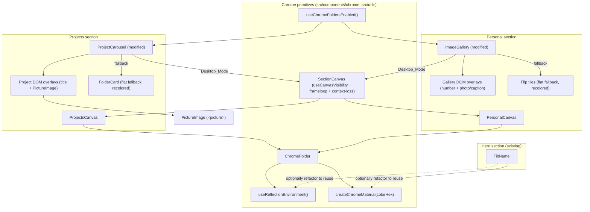

# Design Document

## Overview

This feature replaces the flat CSS folder cards in the Projects carousel and the Personal photo grid with chrome 3D folder models rendered in WebGL, reusing the chrome aesthetic already proven in the hero section (`src/components/TiltName.js`). The core strategy is to **generalize the hero's chrome pipeline** — the equirectangular reflection environment map and the polished `MeshStandardMaterial` — into a small, shared subsystem that all three sections (hero, projects, personal) can draw from, then layer section-specific behavior (carousel windowing, hover-lift, 3D flip) on top of a single reusable `ChromeFolder` component.

The 3D folders are **desktop-exclusive**. Mobile, reduced-motion, and WebGL-unavailable visitors keep the existing flat `FolderCard` / gallery markup, recolored to the page background (`--page-bg`). Each section uses **one shared WebGL `<Canvas>`** (not one canvas per folder) that mounts only when near the viewport and renders on demand, keeping the site within the browser's WebGL context budget (Requirements 2, 7).

Design decisions are grounded in what already works in the repo:

- The hero already loads a JPEG via `TextureLoader` (not drei `<Environment>`, which routes JPEGs through a gain-map HDR loader and blanks the canvas) and tags it `LinearSRGBColorSpace`. We reuse that exact approach (Requirement 7.4).
- The hero already demonstrates demand-frameloop rendering gated by `useCanvasVisibility` with mount/render margins. We reuse that utility unchanged for both new canvases (Requirement 2).
- Text and images stay as **DOM overlays** positioned over the 3D folders rather than being rendered as WebGL textures, so titles, captions, and cover images remain crisp, selectable, and accessible (Requirements 3.4, 5.2).

This design covers the architecture, each new/modified file, data shapes, correctness properties, error handling, and a verification strategy. It does **not** include an implementation task list — that is the next phase.

## Architecture

### Layered structure

The subsystem is organized into three layers so the hero, projects, and personal sections share one env-map load and one material per finish (Requirements 2.9, 7.5):

1. **Chrome primitives (shared, section-agnostic)**
   - `useReflectionEnvironment()` — load the reflection texture, set it as `scene.environment`, return it for use as a material `envMap`. Extracted verbatim from the hero.
   - `createChromeMaterial(colorHex, overrides)` — a factory returning a configured `MeshStandardMaterial` for a given finish (silver for projects/hero, blue/cyan for personal).
   - `ChromeFolder` — loads `folder.glb` once, renders an independent scene-graph instance per folder, applies the shared finish material, and accepts transform/animation props.
   - `useChromeFoldersEnabled()` — the Desktop_Mode detector (viewport + pointer + reduced-motion + WebGL availability).
   - `SectionCanvas` — a thin wrapper combining `useCanvasVisibility` + mount/frameloop gating + context-loss handling.

2. **Section renderers (section-specific 3D logic)**
   - `ProjectsCanvas` — maps the active/prev/next carousel window to three `ChromeFolder` positions; applies pointer tilt to the active folder.
   - `PersonalCanvas` — maps the DOM grid to a grid of `ChromeFolder` instances; drives hover-lift and 3D flip.

3. **Section integration (DOM + overlay + fallback switching)**
   - `ProjectCarousel` (modified) — chooses chrome vs flat path, renders the DOM overlay layer, keeps overlays aligned to folders, delegates click → existing `Modal`.
   - `ImageGallery` (modified) — chooses chrome vs flat path, renders photo/caption overlays, exposes focusable flip controls.
   - A `PictureImage` component — serves WebP with original-format fallback via `<picture>` for cover, gallery, and modal images.

### Shared material and env-map reuse

Within a section, exactly one `Reflection_Environment_Map` and one `Chrome_Material` per finish are created and shared across all folders in that section (Requirements 2.9, 7.5). This mirrors the hero, which builds a single `chromeMaterial` and assigns it to every mesh. The GLB **geometry** is shared across folder instances; only the scene-graph node (transform) is independent per folder — see "ChromeFolder cloning" below.

### Component hierarchy



### Mount budget (Requirement 2.4, 7.1)

The site has four candidate canvas sections top-to-bottom: hero, about, projects, personal. Each `SectionCanvas` mounts its WebGL context only within `useCanvasVisibility`'s mount margin (`600px`) and unmounts beyond it. Because projects and personal are adjacent, a scroll that straddles both could in principle mount two canvases at once — which is within the stated budget of "no more than two" (Requirement 2.4). Hero is far above and about has no WebGL canvas today, so the realistic worst case during a projects↔personal transition is two mounted contexts. The `600px` mount margin is wide enough to pre-create the next context before it scrolls in (avoiding a pop) but narrow enough that three section canvases are not simultaneously within margin at a typical viewport height. This is the key invariant verified in the Correctness Properties and Testing Strategy sections.

## Components and Interfaces

### New files

#### `src/utils/chromeMaterial.js`
Extracts and generalizes the hero's chrome pipeline so all sections share it.

- `REFLECTION_IMAGE_URL` — `'/assets/backgrounds/hero-image.jpg'` (same source the hero uses).
- `useReflectionEnvironment(url = REFLECTION_IMAGE_URL)` → `THREE.Texture`
  - Loads via `useLoader(TextureLoader, url)`; sets `mapping = EquirectangularReflectionMapping`, `colorSpace = LinearSRGBColorSpace`; assigns `scene.environment` in a `useLayoutEffect`, restoring the previous environment on cleanup; calls `invalidate()`. Returns the texture (Requirements 2.9, 7.4).
- `createChromeMaterial(colorHex, overrides = {})` → `THREE.MeshStandardMaterial`
  - Returns `new MeshStandardMaterial({ color: new Color(colorHex), metalness: 1, roughness: 0.1, envMapIntensity: 1.1, ...overrides })`. Silver uses `#eef2f7` (hero value). Blue/cyan uses a tinted hex (e.g. `#bfe6ff`) with a slightly higher `envMapIntensity` to keep reflections bright (Requirements 3.1, 5.1).
- `SILVER_CHROME = '#eef2f7'`, `BLUE_CYAN_CHROME = '#bfe6ff'` — exported finish constants.

Note: the hero (`TiltName.js`) MAY be refactored to import these, but MUST keep rendering identically (same color, same material params, same env-map handling). This is optional cleanup, not a requirement.

#### `src/components/chrome/ChromeFolder.js`
Reusable 3D folder. One per visible folder in a section.

- Props:
  - `material: MeshStandardMaterial` — the shared finish material (passed down so it is not recreated per folder, Requirement 7.5).
  - `position: [x, y, z]`, `scale: number` — placement within the section's canvas.
  - `tilt?: { x, y }` — target tilt (projects active folder, Requirement 3.7).
  - `lift?: number`, `hoverTilt?: { x, y }` — hover animation targets (personal, Requirement 5.3–5.4).
  - `flip?: number` — target Y rotation in radians (0 or π) for the personal flip (Requirement 5.6–5.7).
  - `onFlipMidpoint?: () => void` — fired as rotation crosses π/2 so the overlay content swaps at the flip midpoint (Requirements 5.6, 5.7).
  - `animating?: boolean` — gates `useFrame` work so only moving folders compute (Requirement 5.5).
- Behavior:
  - Loads the model with `useGLTF(FOLDER_MODEL_URL)` (drei caches the parsed GLTF).
  - **ChromeFolder cloning:** multiple folders share one loaded GLTF but each needs its own transform, so each instance renders `useMemo(() => gltf.scene.clone(true), [gltf.scene])`. `Object3D.clone(true)` produces an independent node graph that **shares the underlying `BufferGeometry`** (geometry is not deep-copied), so the GPU uploads one geometry while each folder animates independently. The shared finish material is then assigned to every mesh of the clone (as the hero does via `traverse`), and any embedded camera nodes are removed (the hero does this too). This gives independent transforms without duplicating geometry or material (Requirements 2.9, 7.5).
  - Model fitting reuses a `getFitScale` helper (lifted from the hero) against a `Box3` size; a resting rotation can be applied if the folder GLB, like the hero GLB, ships rotated.
  - `useFrame` lerps current → target for tilt/lift/flip with the hero's `response = 1 - Math.exp(-k * delta)` easing and calls `state.invalidate()` while still moving, so the demand frameloop renders only during motion (Requirement 2.8). When `animating` is false and already at rest, it does no per-frame work.

#### `src/components/chrome/SectionCanvas.js`
Wraps the r3f `<Canvas>` with the project's visibility/frameloop/context-loss conventions so `ProjectsCanvas` and `PersonalCanvas` do not each re-implement them.

- Props: `containerRef`, `camera`, `children`, optional `onContextStatusChange`.
- Behavior:
  - Calls `useCanvasVisibility(containerRef)` → `{ visible, mounted }`.
  - Renders `<Canvas>` only when `mounted`; sets `frameloop={visible ? 'demand' : 'never'}`, `dpr={[1, 1.25]}`, `gl={{ alpha: true, powerPreference: 'high-performance' }}` (matching hero conventions) (Requirements 2.5–2.8).
  - Registers `webglcontextlost` / `webglcontextrestored` listeners on the canvas (via the r3f `gl` instance) to stop/restart rendering without a reload (Requirements 2.10, Error Handling).
- Returns `null` (renders nothing) when `!mounted`, which **unmounts the context and frees the GPU slot** (Requirements 2.5, 7.2).

#### `src/components/chrome/ProjectsCanvas.js`
Projects-specific 3D renderer. Rendered inside a `SectionCanvas`.

- Props: `activeIndex: number`, `projects: Project[]`, `tiltTarget: {x,y} | null`, `onFolderRects: (rects) => void`.
- Behavior:
  - Computes the circular 3-folder window `{ prevIndex, activeIndex, nextIndex }` where before index 0 is index 5 and after index 5 is index 0 (Requirement 3.2–3.3).
  - Renders **exactly three** `ChromeFolder` instances at prev/active/next positions mapped to the carousel's existing offset layout (−1 / 0 / +1 slots); never more (Requirements 3.2, 3.3).
  - Applies the shared silver material to all three (Requirement 3.1).
  - Applies `tilt` only to the active folder (Requirement 3.7).
  - Projects each folder's world-space bounding box to screen space (via the r3f camera) each frame it moves and reports pixel rects through `onFolderRects`, so the DOM overlay layer can track the folder — including while the active folder's tilt changes (Requirement 3.4).

#### `src/components/chrome/PersonalCanvas.js`
Personal-grid 3D renderer. Rendered inside a `SectionCanvas`.

- Props: `photos: Photo[]`, `columns: number`, `hoveredId: string | null`, `flipState: Record<id, 'photo'|'caption'>`, `onFolderRects`, `onFlipMidpoint(id)`.
- Behavior:
  - Lays out up to N `ChromeFolder` instances in a grid matching the DOM grid (5/4/3 columns per the existing breakpoints), with N capped to the visible tile count (Requirement 5.2).
  - Applies the shared blue/cyan material to all folders (Requirement 5.1).
  - Animates **only** the hovered folder (lift + tilt) and leaves the rest at rest; `animating` is set only for the hovered/flipping folder (Requirements 5.3–5.5).
  - Drives per-folder `flip` toward 0 or π and fires `onFlipMidpoint(id)` as it crosses π/2 (Requirements 5.6, 5.7, 5.9).
  - Reports folder screen rects via `onFolderRects` so overlays stay within 2px (Requirement 5.2).

#### `src/components/chrome/useChromeFoldersEnabled.js`
Single source of truth for Desktop_Mode (Requirements 1.1–1.4, 1.6).

- Returns `boolean`, recomputed on media-query and resize changes:
  - `NOT matchMedia('(max-width: 700px)')` AND
  - `matchMedia('(hover: hover) and (pointer: fine)')` AND
  - `NOT matchMedia('(prefers-reduced-motion: reduce)')` AND
  - `isWebGLAvailable()` (a small probe that creates a throwaway canvas and requests `webgl2`/`webgl`, returning false if the context is null or throws).
- Subscribes to all three media queries' `change` events and to `resize`, updating state so the active mode switches after the change settles (Requirement 1.6). The WebGL probe runs once (availability does not change at runtime) and is cached.

#### `src/components/common/PictureImage.js`
`<picture>`-based image for cover, gallery, and modal (Requirement 6.3).

- Props: `src` (original-format path), `webp` (webp path), `alt`, plus pass-through `loading`/`decoding`/`className`.
- Renders `<picture><source srcSet={webp} type="image/webp" /></picture>` so the browser picks WebP when supported and falls back otherwise (Requirements 6.2, 6.3).

#### `scripts/convert-images-to-webp.js` (build/convert step)
A Node script (run via `node scripts/convert-images-to-webp.js`) that generates a `.webp` next to each project cover and gallery source, and converts the one HEIC source, retaining originals (Requirements 6.1, 6.2). It uses `sharp` (dev dependency) which decodes JPEG/PNG/HEIC and encodes WebP. Images to convert (project covers + gallery sources referenced by `projects.json`):

- `public/images/icon-placeholder.jpg` (chaiko cover + gallery, camera-calibration cover + gallery)
- `public/images/melodie.jpg` (melodie cover + gallery)
- `public/images/rear-wing.jpg` (uwfe-aero cover + gallery)
- `public/images/servo-depositor.jpg` (servo-depositor cover + gallery)
- `public/images/tsi-nozzle.png` (tsi-nozzles cover + gallery)
- `public/images/1.heic` → `1.webp` (the sole HEIC file; it is not yet referenced by `projects.json` but Requirement 6.1 calls out converting the HEIC image, so it is included and its original retained).

Personal gallery images are already `.webp`, so they need no conversion; `PictureImage` for the gallery can supply the existing `.webp` with no additional fallback, or omit the `<source>` and render a plain `` where no original-format twin exists.

### Modified files

#### `src/utils/modelPaths.js`
Add `export const FOLDER_MODEL_URL = process.env.REACT_APP_FOLDER_MODEL_URL || '/assets/models/folder.glb';` alongside the existing `HERO_NAME_MODEL_URL` and `ABOUT_MODEL_URL`.

#### `src/components/ProjectCarousel.js`
- Call `useChromeFoldersEnabled()`. When false (mobile / reduced-motion / no WebGL), render the **existing** flat `FolderCard` carousel path unchanged except for the fallback recolor (Requirements 1.2–1.5).
- When true, render a `SectionCanvas` holding `ProjectsCanvas`, plus a **DOM overlay layer**: for each of the three visible folders, an absolutely-positioned overlay with the project title and the cover image (`PictureImage`), positioned from the rects reported by `onFolderRects` and updated as tilt changes (Requirement 3.4).
- Title auto-fit overlay: reuse the existing `fitTitle` canvas-measure routine but add a **12px floor**; if the longest word still overflows at 12px, hold 12px and apply CSS truncation (`overflow: hidden; text-overflow: ellipsis; white-space: nowrap`) for a visible ellipsis (Requirements 3.5, 3.6).
- Keep the existing swipe (`handlePointerDown/Up`), arrow-key (`handleKeyDown`), and prev/next button handlers; they update `index`, which recomputes the 3-folder window (Requirements 3.9, 3.10).
- Clicking the active folder's overlay opens the existing `Modal` via the existing `setSelected` path, unchanged (Requirement 3.8).
- Pointer tilt: a window `pointermove` → `tiltTarget` mapping (same math as the hero), passed to `ProjectsCanvas`, applied to the active folder only, gated on `(hover: hover) and (pointer: fine)` (Requirement 3.7).

#### `src/components/ProjectCarousel.css`
- **Vertical sizing fix (Requirement 4):** replace `.carousel-stage { height: min(68vh, 580px); }` with a clamp that uses dynamic viewport height and a sensible lower bound, e.g. `height: clamp(340px, 68dvh, 580px);`. `dvh` tracks the actual (not initial) viewport so mobile browser chrome collapse does not clip; the `clamp` floor guarantees a minimum stage height on short windows, and the ceiling preserves the current large-screen size. The 3D folder fit (`getFitScale` in `ProjectsCanvas`) derives its scale from the canvas's measured pixel height, so when the stage shrinks or grows the active folder re-fits and is never clipped (Requirements 4.1–4.3). The flat fallback path benefits from the same stage clamp.

#### `src/components/imagegallery.js`
- Call `useChromeFoldersEnabled()`. When false, render the **existing** flip-tile grid unchanged except for fallback recolor (Requirements 1.2–1.5).
- When true, render a `SectionCanvas` holding `PersonalCanvas`, plus a DOM overlay layer per tile: the photo number, the photo (`PictureImage`), and the caption, positioned within 2px of each folder from `onFolderRects` (Requirement 5.2).
- Track `hoveredId` (pointer enter/leave) and `flipState[id]` (`'photo'|'caption'`). Pointer enter/leave drive hover-lift on the hovered folder only (Requirements 5.3–5.5). Click or keyboard (Enter/Space) on a focusable control toggles `flipState[id]`, driving the 3D flip; the overlay content swaps from photo↔caption when `onFlipMidpoint(id)` fires (Requirements 5.6, 5.7).
- Each folder's control is a focusable `<button>` with `aria-pressed` and an `aria-label` reflecting whether it currently shows the photo or the caption (Requirement 5.8), matching the existing gallery button semantics.
- If the pointer leaves mid-flip, the flip target is held until it completes before the hover-lift returns to rest — implemented by only resetting lift once `flip` has reached its target (Requirement 5.9).

#### `src/components/imagegallery.css` and `src/components/FolderCard.css`
- Add a fallback modifier (e.g. a `data-fallback` attribute or class) that sets the folder tab and body background to `var(--page-bg)` as a single shared color when the flat fallback is active (Requirement 1.5). The existing `--blue-panel` styling remains the default for any non-fallback flat usage.

#### `src/data/projects.json`
- Add a `coverWebp` field (and, where the modal/gallery needs it, webp paths in `gallery[]`) pointing at the migrated `.webp` sources, while keeping the existing original-format paths as fallback (Requirements 6.2, 6.4). See Data Models.

#### `src/components/modal.js`
- Swap the cover/gallery `` usages to `PictureImage` so the modal also benefits from WebP with fallback (Requirement 6.3). Modal behavior is otherwise unchanged (Requirement 3.8).

## Data Models

### Project (src/data/projects.json)

Current shape (per entry): `id`, `title`, `coverImage`, `description`, `tools`, `why`, `how`, `gallery: [{ type: 'image'|'video', src }]`.

Migrated shape adds WebP companions while retaining originals (Requirements 6.2, 6.4):

```json
{
  "id": "melodie",
  "title": "melodie",
  "coverImage": "/images/melodie.jpg",
  "coverWebp": "/images/melodie.webp",
  "description": "…",
  "tools": "…",
  "why": "…",
  "how": "…",
  "gallery": [
    { "type": "image", "src": "/images/melodie.jpg", "webp": "/images/melodie.webp" },
    { "type": "video", "src": "/videos/placeholder-video.mp4" }
  ]
}
```

Rules:
- `coverImage` (original) is always present; `coverWebp` is present when a WebP twin exists.
- For `gallery` items, `type: 'image'` entries gain an optional `webp`; `type: 'video'` entries are unchanged.
- `PictureImage` renders the `<source>` only when a `webp` value is present; otherwise it degrades to a plain ``.

### Photo (src/data/personal-gallery.json)

Unchanged shape: `{ id, image, caption }`, with `image` already a `.webp` filename resolved against `/assets/personal-gallery/`. No migration needed (personal images are already WebP). The DOM overlay reads `id` (number), `image` (photo), and `caption`.

### Folder layout parameters (runtime, not persisted)

- **Projects window:** `{ prevIndex, activeIndex, nextIndex }` computed circularly over 6 projects. 3D positions map to the existing carousel offsets: prev at `--slide-x: -12%` equivalent, active centered, next at `+12%` equivalent, with the active folder larger (scale 1) and neighbors smaller (≈0.92), matching the current CSS feel.
- **Personal grid:** `columns` ∈ {5, 4, 3} by breakpoint (>1000 / ≤1000 / ≤720), `rows = 2`, so visible count ∈ {10, 8, 6} — matching the existing `nth-child` caps. Each folder's grid cell center maps to a canvas position.
- **FolderRect:** `{ id, left, top, width, height }` in CSS pixels relative to the canvas container, produced by projecting each folder's 3D bounds to screen space; consumed by the DOM overlay layer to stay aligned (within 2px for personal, and tracking tilt for the projects active folder).
- **Finish:** `SILVER_CHROME = '#eef2f7'` (projects), `BLUE_CYAN_CHROME = '#bfe6ff'` (personal); shared material instance per finish per section.

## Correctness Properties

*A property is a characteristic or behavior that should hold true across all valid executions of a system — essentially, a formal statement about what the system should do. Properties serve as the bridge between human-readable specifications and machine-verifiable correctness guarantees.*

The core of this feature decomposes into several **pure functions** with clear input/output behavior — the mode-selection predicate, the circular carousel window, the title auto-fit, the vertical fit scale, and the flip midpoint-swap rule — plus structural invariants over the rendered folder set (one canvas per section, ≤2 mounted canvases, shared materials, overlay alignment). These are exactly the kinds of logic where property-based testing adds value, so the following properties are written for property-based tests. Section rendering wiring, context-loss recovery, and build-artifact existence are covered by example/integration tests in the Testing Strategy instead.

### Property 1: Mode selection is chrome only when all conditions hold

*For any* combination of the four boolean inputs `(viewportNarrow, hoverFine, reducedMotion, webglAvailable)`, the mode selector returns chrome **if and only if** `(NOT viewportNarrow) AND hoverFine AND (NOT reducedMotion) AND webglAvailable`; in every other combination it returns the flat fallback.

**Validates: Requirements 1.1, 1.2, 1.3, 1.4**

### Property 2: One canvas per section regardless of folder count

*For any* number of folders `n ≥ 1` rendered in a section in Desktop_Mode, that section creates exactly one WebGL canvas.

**Validates: Requirements 2.1, 2.2, 2.3**

### Property 3: At most two section canvases mounted at any scroll position

*For any* scroll position over the page, the number of section canvases (hero, about, projects, personal) whose `useCanvasVisibility.mounted` flag is true is at most two.

**Validates: Requirements 2.4, 7.1**

### Property 4: One shared env map and material per finish per section

*For any* number of folders in a section, exactly one Reflection_Environment_Map and exactly one Chrome_Material per finish are created for that section, and every folder of that finish references the same material instance.

**Validates: Requirements 2.9, 7.5**

### Property 5: Every folder uses its section's shared finish material

*For any* finish `f` (silver for projects, blue/cyan for personal) and any set of rendered folders in that section, every rendered folder references the shared material instance for `f`.

**Validates: Requirements 3.1, 5.1**

### Property 6: Projects render the exact circular three-folder window

*For any* active index `a` over the six projects, the set of rendered Project_Chrome_Folder indices is exactly `{ (a - 1 + 6) mod 6, a, (a + 1) mod 6 }` — size exactly three, with "before 0 → 5" and "after 5 → 0" wrapping — and no other project index is rendered as a chrome panel.

**Validates: Requirements 3.2, 3.3, 3.10**

### Property 7: Overlays stay aligned to their folders within tolerance

*For any* rendered folder and any valid folder transform (including the active projects folder's pointer-tilt range and personal folders at rest), the projected DOM_Overlay rectangle stays within the finish's tolerance of the folder's projected screen rectangle — within 2px for Personal_Chrome_Folder overlays, and tracking the tilt transform for the active Project_Chrome_Folder overlay.

**Validates: Requirements 3.4, 5.2**

### Property 8: Title auto-fit respects the 12px floor and truncates at the floor

*For any* title text and available overlay width, the fitted font size lies in the closed range `[12px, baseSize]`; if the longest word fits within the available width at some size `≥ 12px`, the fitted size renders the longest word within the available width; and if the longest word still overflows at 12px, the size is held at exactly 12px and a visible truncation indicator is applied.

**Validates: Requirements 3.5, 3.6**

### Property 9: Pointer tilt is bounded and applied to the active folder only

*For any* pointer position, the computed tilt target is within the configured bounds, and the tilt is applied only to the active Project_Chrome_Folder while the preceding and following folders receive no tilt.

**Validates: Requirements 3.7**

### Property 10: Active folder fits within the stage vertically for any stage height

*For any* carousel stage height and model height, the fit scale produces a scaled folder height that is less than or equal to the available stage height; consequently, decreasing the stage height never leaves the active folder clipped, and increasing it grows the folder without exceeding the stage.

**Validates: Requirements 4.1, 4.2, 4.3**

### Property 11: Hover affects only the hovered folder and is reversible

*For any* set of Personal_Chrome_Folder instances and any single hovered folder id, only the hovered folder has a nonzero lift/tilt target while every other folder remains at its resting target; and for any folder, a pointer-enter followed by a pointer-leave restores that folder to its resting lift and tilt.

**Validates: Requirements 5.3, 5.4, 5.5**

### Property 12: Flip swaps the overlay face exactly at the midpoint

*For any* flip direction (photo→caption or caption→photo) and any flip progress `p` in `[0, π]`, the displayed overlay face is the starting face while `p < π/2` and the target face while `p ≥ π/2`.

**Validates: Requirements 5.6, 5.7**

### Property 13: A pointer-leave during a flip completes the flip before resting

*For any* time at which the pointer leaves a Personal_Chrome_Folder while a flip animation is in progress, the folder reaches its target flip orientation before its lift returns to the resting position.

**Validates: Requirements 5.9**

### Property 14: Each personal folder control is focusable with a state-accurate label

*For any* Personal_Chrome_Folder and any current face (photo or caption), the folder's control is a focusable element whose accessible label and pressed state reflect whether the photo or the caption is currently shown.

**Validates: Requirements 5.8**

### Property 15: PictureImage offers WebP with original-format fallback

*For any* image specified with both a WebP source and an original-format source, `PictureImage` renders a `<source>` with `type="image/webp"` and an `` whose `src` is the original-format source; for any image specified with only an original source, it renders a plain `` with that source and no `<source>`.

**Validates: Requirements 6.2, 6.3**

## Error Handling

- **WebGL unavailable (Requirement 1.4):** `useChromeFoldersEnabled()` probes WebGL once at startup (a throwaway canvas requesting `webgl2` then `webgl`, treating a null context or a thrown exception as unavailable). When unavailable, the hook returns false and both sections render the flat fallback — no `SectionCanvas` is ever mounted, so no context is requested.
- **WebGL context loss (Requirements 2.10, 7.1):** `SectionCanvas` listens for `webglcontextlost` (call `preventDefault()` so the context can be restored) and `webglcontextrestored`. On loss it stops the render loop (sets frameloop to never / halts invalidation); on restore it re-enables the demand loop and triggers a single invalidate to repaint. No page reload is required. If restoration does not fire within a short grace period, the section falls back to the flat path for that mount so the user still sees content.
- **GLB load failure (`folder.glb`):** `ChromeFolder` loads the model under a React `<Suspense>` boundary (as the hero does). An error boundary around the `SectionCanvas` catches a failed `useGLTF`/loader rejection and renders the flat fallback for that section instead of a blank canvas. The failure is logged once; it does not crash the page.
- **Reflection image load failure:** if the equirectangular source fails to load, the chrome material still renders (metallic surface without a mirrored environment) rather than throwing; the folder remains visible. This degrades gracefully because `envMap` being absent is valid for `MeshStandardMaterial`.
- **Image load failure (cover/gallery/personal):** `PictureImage` renders an `` with existing `loading="lazy"` / `decoding="async"`; a broken image shows the browser's default and does not break layout. The DOM overlay (title/number/caption) remains readable because it is independent of the image.
- **Media-query / resize churn (Requirement 1.6):** mode changes are driven by `change`/`resize` listeners that update state; React re-renders switch the path after the change settles. Rapid toggling simply swaps paths; because the fallback and chrome paths are mutually exclusive, no more than one path is mounted per section at a time.

## Testing Strategy

### Dual approach

- **Property-based tests** verify the universal properties above (pure predicates and structural invariants). The project uses Jest via `react-scripts test` (`@testing-library/react` is already a dependency). Add **`fast-check`** as the property-based testing library (idiomatic for the JS/Jest stack); do not hand-roll generators. Each property test runs a minimum of **100 iterations** and is tagged with a comment referencing its design property, using the format: `// Feature: chrome-3d-folders, Property N: <property text>`.
- **Example and integration tests** cover rendering wiring, context lifecycle, accessibility, and build artifacts that are not input-varying.

### Property test mapping

Pure logic is extracted into small testable modules so properties can be exercised without a live GPU:

- **Property 1** — unit-test the mode predicate over all 16 input combinations (fast-check `boolean` tuples).
- **Property 6** — unit-test `windowFor(activeIndex, length)` over all active indices (and arbitrary lengths ≥ 3) asserting the exact circular 3-set.
- **Property 8** — unit-test `fitTitle(text, availableWidth, baseSize)` over arbitrary strings/widths using an injectable text-measure stub, asserting the `[12, base]` range, fit-when-achievable, and truncate-at-floor.
- **Property 10** — unit-test `fitScale(stageHeight, modelHeight)` over arbitrary positive heights asserting `scaledHeight ≤ stageHeight` and monotonicity.
- **Property 12** — unit-test the midpoint-swap selector `faceFor(progress, from, to)` over `progress ∈ [0, π]`.
- **Properties 2, 4, 5, 9, 11, 14** — render the section (chrome path) with r3f mocked/stubbed and the material factory spied, over arbitrary folder counts / hovered ids / face states, asserting canvas count, material-instance reuse, finish assignment, tilt-only-active, hover isolation + round-trip, and accessible-label correctness.
- **Property 3** — simulate `useCanvasVisibility.mounted` states for the four sections across a generated range of scroll offsets, asserting the mounted count never exceeds two.
- **Property 7** — unit-test the overlay-rect-from-folder-rect projection over arbitrary transforms within range, asserting the tolerance bound (2px personal; tilt-tracking projects) using a deterministic projection function.
- **Property 13** — unit-test the flip/lift state machine: for an arbitrary leave time during an in-progress flip, assert the flip reaches its target before lift resets.
- **Property 15** — render `PictureImage` with arbitrary `(webp, original)` pairs and with `original`-only, asserting the `<source type="image/webp">` + `` structure.

### Example / integration tests

- **Requirements 1.5, 1.6:** render the fallback path, assert tab/body computed background resolves to `--page-bg`; simulate `matchMedia` `change` events and assert the path flips between chrome and flat.
- **Requirements 2.5–2.8, 2.10:** toggle `mounted`/`visible` and assert canvas mount/unmount and the `frameloop` prop (`demand` vs `never`); dispatch synthetic `webglcontextlost`/`webglcontextrestored` and assert the loop stops then resumes without reload; assert idle renders zero frames and an interaction triggers a render (spy on `invalidate`).
- **Requirements 3.8, 3.9:** click the active overlay → existing `Modal` opens with that project (Modal unchanged); click a neighbor overlay → it becomes active.
- **Requirement 7.4:** after `useReflectionEnvironment`, assert `texture.colorSpace === LinearSRGBColorSpace` and `texture.mapping === EquirectangularReflectionMapping`.
- **Requirements 6.1, 6.2, 6.4:** after running the convert script, assert a `.webp` twin exists for every referenced original (and for the HEIC source) and that every original still exists; validate `projects.json` carries `webp`/`coverWebp` fields where twins exist while retaining originals.

### Visual and performance verification (headless)

Logic tests cannot confirm the chrome actually renders or that scroll stays smooth. For those, use **`playwright-core`** (already used earlier in this project for headless inspection) to:

- Load the running dev build, scroll to the Projects and Personal sections, and capture screenshots confirming three silver folders (projects) and the blue/cyan grid (personal) render with reflections.
- Assert at runtime that `document.querySelectorAll('canvas').length ≤ 2` while scrolling through the projects↔personal boundary (Property 3 / Requirement 2.4 in a real browser).
- Verify the vertical-sizing fix by resizing the viewport to a short height and screenshotting that the active project folder is not clipped (Requirement 4).
- Confirm on-demand rendering by sampling that no frames are drawn while the section is idle and visible (e.g. hooking `requestAnimationFrame`/the r3f render count), then that interaction produces frames (Requirement 2.8).

### Accessibility checks

- Keyboard-operate the personal folders (Tab to focus, Enter/Space to flip) and assert `aria-pressed` and the `aria-label` update to reflect photo vs caption (Requirement 5.8).
- Confirm the flat fallback remains fully keyboard-accessible on mobile/reduced-motion, matching current behavior.
